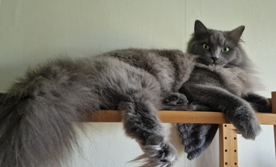

# ada



_Named after Ada, regal matriarch, at her behest._

The fastest terminal markdown viewer, for one note or a whole vault.

Sortable tables, mermaid diagrams drawn as text, inline images, a git gutter, and `[[wiki links]]`
that find their note anywhere in the vault. It opens code, logs, JSON and images too, so it also
pages your pipes and fills fzf's preview pane.


More of it, one feature at a time, on [the site](https://junkdog.github.io/ada-md/).

## Goals

- **The fastest, and the leanest:** first on wall time, CPU and memory against every other
  terminal viewer. An idle ada doesn't wake at all.
- **Easy to live with:** vim keys and the mouse both work, themes preview as you move through
  them, settings apply behind their popup, and back returns to the same spot.
- **Small on purpose:** what a note and a vault of linked notes need, from an
  [LLM wiki](https://gist.github.com/karpathy/442a6bf555914893e9891c11519de94f) to Obsidian.
  No file browser, no editor, no math.
- **Never crashes:** safe Rust from parsing to drawing, and whole sessions fuzzed for hours.

## Highlights

- **Tables that know their units:** `s` sorts by any column, and `350 µs`, `1m 30s` and `€420`
  sort by value. A table too wide for the terminal turns into cards.
- **The best-looking mermaid in a terminal:** sequence diagrams, flowcharts, state, class and
  gantt diagrams, drawn as text, fitted to the width and colored by the theme, in `--print` too.
- **Wiki links that survive moves:** a `[[link]]` is found by name anywhere in the vault, as in
  Obsidian.
- **Search that sees through markup:** a regex `foo bar` finds `**foo** _bar_`.
- **One previewer for fzf:** notes, code, logs, JSON and images, in place of both `bat` and
  `kitten icat`.

Also: inline images over kitty, sixel or iTerm2, a git gutter, live reload, callouts and
footnotes, fourteen themes and your own, remappable keys, and `--record` and `--replay` to turn
a session into a bug report.

## Performance

ada is measured against nine other terminal markdown viewers, five of them interactive, and bat,
on wall time, CPU and memory, and leads on nearly every measurement:

- **Reading:** first paint, scrolling, search, resize and reload, from a short note to a 2 MB one.
- **Printing and previews:** the fastest printer that renders and highlights, and ahead of bat as
  an fzf previewer on code, JSON and logs.
- **Images:** faster previews than `kitten icat`, chafa, viu and mcat, in a fraction of the memory.
- **Diagrams:** flowcharts that take other renderers seconds take ada milliseconds.

Charts are on [the site](https://junkdog.github.io/ada-md/#performance); the harnesses are
[`bench/b2`](bench/b2/README.md), [`examples/diagram_bench.rs`](examples/diagram_bench.rs) and
[`bench/diagrams/compare`](bench/diagrams/compare/src/main.rs) (against mermaid-text and mmdflux).

## Install

Binaries for Linux (x86_64, aarch64), macOS (Apple silicon, Intel) and Windows (x86_64, a `.zip`)
are on the [releases page](https://github.com/junkdog/ada-md/releases). The Linux `gnu` binaries
need glibc 2.34 or newer; the `musl` ones are static and run on any Linux, Alpine included, but
print large files in up to 1.4× the time. From [crates.io](https://crates.io/crates/ada-md), or
the latest from git:

```zsh
cargo install --locked ada-md
cargo install --locked --git https://github.com/junkdog/ada-md ada-md
```

The release binaries are linked with the code a typical run needs first, which saves up to about
1 MiB of memory on Linux and less than half that on macOS. That takes two links, which
`cargo install` can't do; to build ada as released from a clone (Linux or macOS):

```zsh
cargo ordered --locked   # target/release/ada
```

Rust 1.95 or newer. ada is pure Rust, except for jemalloc in a static musl build, which needs a C
compiler and `make`. Git integration runs the `git` command.

**Windows** is new in 1.1 and has seen less use than Linux and macOS. The config and themes are in
`%APPDATA%\ada`, `~` in `[links] roots` is `%USERPROFILE%`, links and images open in their default
apps, and the editor falls back to `notepad`. Windows Terminal 1.22 and later draws sixel images.

## Usage

```zsh
ada notes/today.md
ada --line 120 notes/today.md        # start at line 120
ada -n all notes/today.md            # line numbers: off, code or all

# from a pipe: markdown, code, JSON, YAML, diffs and logs are told apart by content
git show HEAD~3:README.md | ada
journalctl -b -u sshd | ada
curl -s https://example.com/api | ada -l json   # name the language when the guess is wrong

# code, config files and images
ada src/main.rs
ada plot.png

# print instead of paging, as happens anyway when stdout isn't a terminal
ada --print --width 100 notes/today.md | less -R
```

As an fzf preview, ada prints at the pane's size, images included:

```zsh
fzf --preview 'ada --print {}'
# from rg matches: the matched line lands mid-pane, marked
rg -n . | fzf -d : --preview 'ada --print --line {2} {1}' --preview-window '+{2}-/2'
# a live grep: the preview marks what the query matches
fzf --disabled --ansi -d : --bind 'change:reload:rg -n --color=always --smart-case -- {q} || true' \
    --preview 'ada --print --line {2} --match {q} {1}' --preview-window '+{2}-/2'
# with the git gutter
git ls-files -m | fzf --preview 'ada --print --gutter {}'
```

`--line` marks its line as a jump in the viewer does, and `--match` marks matches as `/` does. A
preview stops 2,000 rows past its line and reads no further, so a huge file previews as fast as a
small one. `--code-wrap off` cuts long lines of code at the pane's edge instead of wrapping them.

Press `?` in ada for the keys, and see `ada --help` for every option.

### Keys

| Keys | Action |
|---|---|
| `j` `k`, `↓` `↑`, `C-e` `C-y` | scroll a row |
| `d` `u`, `C-d` `C-u` | half a page |
| `Space` `b`, `PgDn` `PgUp`, `C-f` `C-b` | a page |
| `g` `G`, `Home` `End` | top, bottom |
| `]]` `[[` | next, previous heading |
| `]c` `[c` | next, previous git change |
| `Tab` `S-Tab` | focus the next, previous link |
| `Enter` | follow the focused link |
| `BS` `H` `C-o`, `L` | back, forward |
| `/`, `n` `N` | search with a regex, next and previous match |
| `o` | the outline: type to filter, `Enter` to jump |
| `l` | the links: type to filter, `Enter` to focus one |
| `t` | tables: auto, grid, records |
| `s` | sort a table by a column; `C-←` `C-→` pick another table |
| `w`, `←` `→` | wrap code, or scroll it sideways |
| `#` | line numbers on or off |
| `B` | the theme's background, or the terminal's |
| `T` | pick a theme, previewing each; `C-←` `C-→` switch between dark and light |
| `r` | read the file again |
| `e` | edit in `$VISUAL` or `$EDITOR` at the current line |
| `y` | copy the selection, the focused link, or the code block on screen |
| `F2` `,` | the settings, changed in place |
| `S` | save the settings in effect to the config file |
| `M` | the mouse, or the terminal's own selection |
| `?` | help |
| `q` `Esc` | quit; `Esc` clears a selection first, and `C-c` always quits |

Search and the lists' filters are smart-case. In the search prompt, `Esc` puts the previous search
back, an empty pattern repeats the last one, and `↑` `↓` walk this session's searches. Prompts and
filters edit as a shell does: `←` `→`, `C-a` `C-e`, `C-u` and `C-w`. A jump tints the rows it
landed on until the next key.

The wheel scrolls, a click follows a link, and a drag, double or triple click selects text, a word,
or a paragraph (a line of code, a table cell). A copy is the document's text, not the screen's:
paragraphs unwrapped, code without line numbers or wrap marks, table cells as tab-separated values,
or as a markdown table once whole rows and the header are in. `y` copies over OSC 52, or every
selection is copied as it's made with `copy_on = "select"`. Most terminals select their own way
with `Shift` held; `M` hands them the mouse, and `mouse = false` starts that way.

## Configuration

ada reads `~/.config/ada/config.toml` (`$XDG_CONFIG_HOME/ada/config.toml`; on Windows,
`%APPDATA%\ada\config.toml`), and flags on the command line win. The first interactive run creates
it with every option commented out at its default. It's the only file ada writes unasked; an empty
file keeps it from coming back.

`F2` or `,` opens the settings: every option with its value, each change shown behind the popup at
once. `•` marks a value the config file doesn't have; `a` keeps the changes for this session, `s`
saves them too, and `Esc` undoes them. Image settings take a restart. `S` saves everything in
effect, the toggles and flags such as `--theme` included, after listing each change as
`old → new`. Saving changes only the values; comments stay.

```toml
theme = "gruvbox-light"
theme_bg = true            # the theme's background, or false for the terminal's (`B`)
mouse = true               # the wheel, link clicks and selecting, or false for the terminal's selection (`M`)
copy_on = "yank"           # copy a selection on `y`, or "select" as it's made
max_width = 100            # wrap prose at most 100 columns wide; tables may use the rest
images = true              # or false for text only
image_protocol = "auto"    # or kitty, sixel, iterm2, halfblocks
live_reload = "auto"       # read the file again when it changes; "notify" marks it until `r`, or "off"
keep_screen = true         # leave what ada showed in the terminal when it quits
tables = "auto"            # the table layout to start with: auto, grid or records
code_wrap = true
line_numbers = "code"      # number rows by source line: off, code (code and text files) or all

[links]
roots = ["~/notes"]       # where links are looked up by name; see Links in a vault
root_markers = [".obsidian"]  # a directory holding one of these is a root too (the default)

[keys]
# setting an action replaces its keys; keys it takes from another action leave it
scroll_down = ["j", "down", "ctrl-n"]
top = "g g"
quit = "q"
```

Keys are written like `j`, `G`, `ctrl-d`, `alt-x`, `shift-up`, `space`, `enter`, `esc`, `tab`,
`pageup` or `f5`, and two in turn as `"]]"` or `"g g"`.

### Links in a vault

A `[[wiki link]]` resolves beside its note first, then by name anywhere under the note's root, as
in Obsidian: the nearest directory above the note that `roots` lists or that holds one of
`root_markers`. An Obsidian vault needs no setup; any other folder of notes takes one line in
`roots`. A bare file name such as `![[cat.png]]` is looked up the same way; a path with folders
stays where it says. Names match ignoring case, and dot folders are skipped. When several files
share a name, the one in a folder named like the note's wins (`10-projects/sift` →
`40-archive/sift`); otherwise the link shows as broken and lists them, and `[[folder/name]]` picks
one.

### Themes

| family | themes |
|---|---|
| gruvbox | `gruvbox-dark` (the default), `gruvbox-light` |
| catppuccin | `catppuccin-mocha`, `catppuccin-macchiato`, `catppuccin-frappe`, `catppuccin-latte` |
| tokyonight | `tokyonight-night`, `tokyonight-storm`, `tokyonight-moon`, `tokyonight-day` |
| rosé pine | `rose-pine`, `rose-pine-moon`, `rose-pine-dawn` |
| dracula | `dracula` |

Each draws its own background; `B` or `theme_bg = false` shows the terminal's behind the text, while
code blocks, heading bars, table stripes and popups keep theirs. `--print` always uses the
terminal's.

Your own go in `~/.config/ada/themes/NAME.toml`, picked with `--theme NAME` or `theme = "NAME"`. `T`
lists the dark or the light themes, previewing each; `C-←` `C-→` switch to the other set, landing on
the counterpart (`gruvbox-dark` ↔ `gruvbox-light`). A theme can extend another:

```toml
extends = "gruvbox-dark"

[inline]
emph = { fg = "#d3869b", italic = true }
link = { fg = "aqua", underline = false }

[glyphs]
bullets = ["-", "+", "*"]
table_border = "ascii"
```

Colors are `#rrggbb`, `#rgb`, a terminal color name or index, or a name from the theme's
`[palette]`. [gruvbox-dark.toml](src/theme/builtin/gruvbox-dark.toml) lists every style. Mistakes
are reported with the file, line and column.

## Tables and diagrams

- **Sorting:** `s` lists the columns of a table on screen; type to filter, `Enter` sorts. Numbers,
  money, percentages and durations sort by value (`1h 30m` after `80m`), other text naturally,
  and empty cells last. The order holds through resizes, navigation and reloads.
- **Sized like a browser's:** columns follow their content, and a table may grow past `max_width`
  to the terminal's width; one that still doesn't fit becomes cards, one per row. `t` cycles
  auto, grid and records.
- **Mermaid:** sequence diagrams, flowcharts, state, class and gantt diagrams are drawn in the
  note, fitted to the width. One too wide scrolls sideways with `←` `→`, with cut labels listed in
  full below it, and search lights up matches in the drawing. Other kinds show as code. `.mmd` and
  `.mermaid` files and piped diagrams are drawn too.
- **Sticky headers:** a long table keeps its header row on top as it scrolls, a sequence diagram
  its participants, and a gantt chart its date axis.

## Other files

Code and config files (`main.rs`, `Cargo.lock`, `Makefile`, `.zshrc`, or a `#!` first line) are
highlighted, with the git gutter, search, `e` and `--line` working on their lines. ada's own lexers
cover 69 languages, plus SQL and regexes inside other languages' strings; the other languages bat
knows open plain, as does other text. Binary files aren't shown. The lexers are a library on
crates.io, [ada-parse](https://crates.io/crates/ada-parse), versioned with ada.

Stdin and files with no extension are judged by their first 8 KB: a diff, a mermaid diagram, JSON,
YAML, TOML, HTML, a log, a config file, code, or markdown. Other piped text is shown line for line,
and a file with no extension falls back to markdown, as a `README` should. A piped png, jpeg or
gif is shown as an image. Logs and JSON highlight at any line length; themes style log levels with
`markup.error`, `markup.warning`, `markup.info` and `markup.debug`. `-l NAME` overrides the guess.

## Images

An image alone in its paragraph is drawn inline, and `Enter` on a link to a png, jpeg or gif shows
it full screen (`Enter` again opens your image viewer). A gif shows its first frame. ada asks the
terminal what it supports: kitty's graphics protocol, then sixel (foot, wezterm), then half-block
characters. Inside tmux it uses half-blocks ([KNOWN_ISSUES.md](KNOWN_ISSUES.md)).
`--image-protocol` overrides the choice, and `--no-images` turns images off.

`--print` draws images too when it writes to a terminal or an fzf pane (or `--height N` is given).
It can't ask the terminal there, so kitty and Ghostty get kitty images and everything else, tmux
included, half-blocks: text cells that fzf clips and scrolls with the pane.

## Editing

`e` opens the file at the first line on screen in `$VISUAL`, `$EDITOR` or `vi` (`notepad` on
Windows): as `+LINE FILE` for vi, vim, neovim, nano, emacs, kakoune and micro, `FILE:LINE` for
helix, and `FILE` for anything else. The setting is split as a shell would, so
`EDITOR="code --wait"` works (on Windows, `\` is a path separator, not an escape). ada reads the
file again when the editor exits.

## Shell completions

```zsh
ada --completions zsh > ${XDG_DATA_HOME:-~/.local/share}/zsh/completions/_ada
ada --completions bash > ${XDG_DATA_HOME:-~/.local/share}/bash-completion/completions/ada
ada --completions fish > ${XDG_CONFIG_HOME:-~/.config}/fish/completions/ada.fish
```

Or `source <(ada --completions zsh)` in `~/.zshrc`, after `compinit`. In PowerShell, add this to
`$PROFILE`:

```powershell
ada --completions powershell | Out-String | Invoke-Expression
```

Theme names and theme file paths complete too.

## Recording sessions

`--record FILE` writes down a session as plain text: what each key did, resizes, and the files and
git output ada read. `--replay FILE` plays it back exactly, even after the files have changed, so
a session becomes a bug report. `--headless` replays it off-screen and prints the last frame.

## Demos

The recording above is made with [VHS](https://github.com/charmbracelet/vhs) from
`demo/demo.tape`, over the made-up notes in `demo/notes`; the site's clips come from
`site/build.zsh`. To record it again:

```zsh
cargo build --release
vhs demo/demo.tape
ffmpeg -y -i demo/demo.gif -c:v libwebp_anim -quality 80 -loop 0 site/media/hero.webp
```

## License

[MIT](LICENSE)
