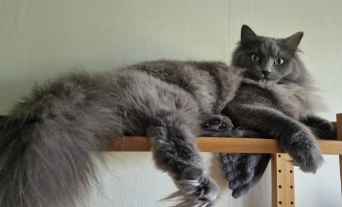

# ada



_Named after Ada, regal matriarch, at her behest._

The fastest terminal markdown viewer, for one note or a whole vault.

Tables you can sort, mermaid diagrams drawn as text, images inline, a git gutter in the margin,
and `[[wiki links]]` that find their note anywhere in the vault. Code, logs, JSON and pictures
open too, so the viewer that reads your notes also pages your pipes and fills fzf's preview pane.


More of it, one feature at a time, on [the site](https://junkdog.github.io/ada-md/).

## Goals

- **The fastest, and the leanest.** Not merely quick: first on wall time, CPU and memory, against
  every other terminal viewer. An idle ada doesn't wake at all.
- **Easy to live with.** Vim keys and the mouse both work, and every change shows at once:
  themes preview as you move through them, settings apply behind their popup, and back returns
  to the same spot with the same link focused.
- **Small on purpose.** What a note needs, and what a vault of linked notes needs, from an
  [LLM wiki](https://gist.github.com/karpathy/442a6bf555914893e9891c11519de94f) to Obsidian.
  No file browser, no editor, no math.
- **Never crashes.** Parsing, layout and drawing are safe Rust. Whole sessions are fuzzed for
  hours, with files, git and images answering late or out of order.

## Standout features

- **Tables that know their units.** `s` sorts by any column, and `350 µs`, `1m 30s` and `€420`
  sort as the values they are. Too wide for the terminal, a table turns into cards
  ([Tables and diagrams](#tables-and-diagrams)).
- **The best-looking mermaid in a terminal.** Sequence diagrams, flowcharts, state diagrams,
  class diagrams and gantt charts, drawn as text with cleanly joined lines, laid out to fit the
  width and colored by the theme, in any terminal and in `--print`.
- **Wiki links that survive moves.** A `[[link]]` is found by name anywhere in the vault, as
  Obsidian does ([Links in a vault](#links-in-a-vault)).
- **Search that sees through markup.** A regex `foo bar` finds `**foo** _bar_`.
- **One previewer for fzf.** Notes, code, logs, JSON and images, at the pane's size: it stands in
  for both `bat` and `kitten icat`.

Also: inline images over kitty, sixel or iTerm2, a git gutter, live reload, callouts and
footnotes, fourteen themes and your own, remappable keys, and `--record` and `--replay` to turn
a session into a bug report.

## Performance

ada is measured against nine other terminal markdown viewers, five of them interactive, and bat,
on wall time, CPU and memory, and leads on nearly every measurement:

- **Reading:** first paint, scrolling, search, resize and reload, from a short note to a 2 MB
  one. An idle ada doesn't wake at all.
- **Printing and previews:** the fastest of the printers that render and highlight, and ahead of
  bat as an fzf previewer on code, JSON and logs.
- **Images:** the fastest previews of every image tool measured, `kitten icat`, chafa, viu and
  mcat, in kitty's graphics protocol and in characters, in a fraction of the memory.
- **Diagrams:** a mermaid diagram is fitted to the width and drawn in microseconds; flowcharts
  that take other renderers seconds take ada milliseconds.

The charts are on [the site](https://junkdog.github.io/ada-md/#performance), the harnesses in
[`bench/b2`](bench/b2/README.md), [`examples/diagram_bench.rs`](examples/diagram_bench.rs) and
[`bench/diagrams/compare`](bench/diagrams/compare/src/main.rs) (against mermaid-text and mmdflux).

## Install

Binaries for Linux (x86_64 and aarch64) and macOS (Apple silicon and Intel) are on the
[releases page](https://github.com/junkdog/ada-md/releases). The Linux `gnu` binaries need glibc
2.34 or newer; the `musl` ones are static and run on any Linux, Alpine included, but print large
files in up to 1.4× the time. To build it from [crates.io](https://crates.io/crates/ada-md):

```zsh
cargo install --locked ada-md
```

or the latest from git: `cargo install --locked --git https://github.com/junkdog/ada-md ada-md`.

The release binaries are linked with the code a typical run needs first, so a run takes up to about
1 MiB less memory on Linux, and less than half that on macOS. That takes two links, which
`cargo install` can't do. To build ada the way the releases are, on Linux (x86_64 and aarch64) and
macOS, from a clone:

```zsh
cargo ordered --locked   # target/release/ada, as released
```

Rust 1.88 or newer, and a C compiler:
syntax highlighting runs on [Oniguruma](https://github.com/kkos/oniguruma), which is built from source. For a pure-Rust
build, add `--no-default-features`. Highlighting then runs on
fancy-regex and looks the same, but each language costs 10–20 ms on first use instead of about
1 ms. Git integration runs the `git` command.

**Windows** is mostly untested. ada builds there, and the pager has run on Windows 10. The config
and themes are in `%APPDATA%\ada` (or `$XDG_CONFIG_HOME\ada`), `~` in `[links] roots` is
`%USERPROFILE%`, links and images open in their default apps, and the editor falls back to
`notepad`. ada asks the terminal what images it draws, as elsewhere: Windows Terminal 1.22 and
later answers sixel. Live reload is told when the file changes, as on Linux; on a network drive
it checks once a second.

There are no Windows binaries; build it with `cargo install`. Windows support is planned for 1.1.

## Usage

```zsh
# read a note
ada notes/today.md

# from a pipe: ada tells markdown, code, JSON, YAML, diffs and logs apart by what they hold
git show HEAD~3:README.md | ada
journalctl -b -u sshd | ada
kubectl get pod ada -o yaml | ada

# when the guess is wrong, name the language (bat's -l): a syntax name or an extension
curl -s https://example.com/api | ada -l json

# start at line 120
ada --line 120 notes/today.md

# not only markdown: code and config files, highlighted, and images
ada src/main.rs
ada ~/.config/ada/config.toml
ada plot.png

# with line numbers: off, code (code and text files) or all (markdown too)
ada -n all notes/today.md

# print instead of paging: what happens anyway when stdout isn't a terminal
ada --print --width 100 notes/today.md | less -R
```

As an fzf preview, which prints at the pane's size (`$FZF_PREVIEW_COLUMNS` and
`$FZF_PREVIEW_LINES`), images included, so it can stand in for both `bat` and `kitten icat`:

```zsh
fzf --preview 'ada --print {}'
# from rg matches: the matched line lands mid-pane, marked
rg -n . | fzf -d : --preview 'ada --print --line {2} {1}' --preview-window '+{2}-/2'
# a live grep: rg reruns as you type, and the preview marks what the query matches
fzf --disabled --ansi -d : --bind 'change:reload:rg -n --color=always --smart-case -- {q} || true' \
    --preview 'ada --print --line {2} --match {q} {1}' --preview-window '+{2}-/2'
# with the git gutter, as the viewer draws it
git ls-files -m | fzf --preview 'ada --print --gutter {}'
```

`--line` marks its line's rows as the viewer marks where a jump landed, and `--match` marks
matches as `/` does, smart-case, those on that line as the current one; a query typed halfway
to a valid regex prints unmarked, with a warning on stderr.

A preview stops 2,000 rows past the line it starts at, and reads no more of a code or log file
than that, so a huge file previews as fast as a small one. Long lines of code wrap in the pane;
`--code-wrap off` cuts them at its edge instead (as `code_wrap = false` in the config does for a
preview), so the previewer needn't follow the viewer's setting.

Press `?` in ada for the keys. See `ada --help` for every option.

### Keys

| Keys | Action |
|---|---|
| `j` `k`, `↓` `↑`, `C-e` `C-y` | scroll a row |
| `d` `u`, `C-d` `C-u` | half a page |
| `Space` `b`, `PgDn` `PgUp`, `C-f` `C-b` | a page |
| `g` `G`, `Home` `End` | top, bottom |
| `]]` `[[` | next, previous heading |
| `]c` `[c` | next, previous git change |
| `Tab` `S-Tab` | focus the next, previous link |
| `Enter` | follow the focused link |
| `BS` `H` `C-o`, `L` | back, forward |
| `/`, `n` `N` | search with a regex, next and previous match |
| `o` | the outline: type to filter, `Enter` to jump |
| `l` | the links: type to filter, `Enter` to focus one |
| `t` | tables: auto, grid, records |
| `s` | sort a table on screen by a column: ascending, descending, source order; `←` `→` pick another table |
| `w`, `←` `→` | wrap code, or scroll it sideways |
| `#` | show or hide line numbers, for code files or for markdown, whichever is shown |
| `B` | the theme's background, or the terminal's |
| `T` | pick a theme, previewing each: `Enter` keeps it, `Esc` goes back; `←` `→` list the dark or the light themes |
| `r` | read the file again |
| `e` | edit in `$VISUAL` or `$EDITOR` at the current line |
| `y` | copy the selection, or else the focused link, or the code block on screen |
| `F2` `,` | the settings: every option with its value, changed in place and shown at once; `a` keeps the changes, `s` saves them too, `Esc` undoes them |
| `S` | save the settings in effect to the config file: a box lists what changes, `Enter` saves, `Esc` cancels |
| `M` | the mouse: the wheel, clicks on links and selecting text, or the terminal's own selection |
| `?` | help |
| `q` `Esc` | quit; `Esc` clears a selection first, and `C-c` always quits |

In the search prompt, `Enter` keeps the matches, `Esc` puts the previous search back, `C-u`
and `C-w` edit, and an empty pattern repeats the last search. Search is smart-case: it ignores case
unless the pattern has an uppercase letter. So are the filters of the outline, links, themes and
columns lists.

Following a link to a heading, a footnote or a line, or picking a heading in the outline, tints the rows it
landed on until the next key, so they stand out even where the end of the document stops the scroll short.

The mouse is on by default: the wheel scrolls the document, the lists and the help, and a click on a
link follows it. A drag selects text, a double click a word, and a triple click a paragraph, a line of
code or a table cell. What it copies is the document's text, not the screen's: a paragraph unwrapped,
code without its padding, line numbers or wrap marks, list items with their markers. Cells across a
table copy as tab-separated values, as a markdown table once whole rows and the header are in, and a
record card's as `header: value` lines. `y` copies the selection (OSC 52, as for links), and `Esc`
clears it; with `copy_on = "select"` in the config or the settings (`F2`), it's copied as it's made. Most terminals (kitty,
wezterm, foot, alacritty, xterm) still select their own way with `Shift` held. `M` gives the mouse to
the terminal, and `mouse = false` in the config starts that way.

## Configuration

ada reads `~/.config/ada/config.toml` (or `$XDG_CONFIG_HOME/ada/config.toml`; on Windows,
`%APPDATA%\ada\config.toml`). Flags on the command line win.

**ada creates this file the first time it runs interactively**, with every option commented
out at its default, so it's a place to look as much as a place to change things.
`--print` and previews read it but never create it. It's the only file ada writes unasked.
Deleted, it comes back on the next interactive run; an empty file in its place keeps it away.

`F2` or `,` opens the settings: each option with its value, grouped, and the key that changes it outside the
popup. `↑` `↓` move, `Space` or `←` `→` change the focused one, digits type the prose width, and `Enter` on the
theme lists the themes. Every change shows behind the popup at once. A mark (`•`) flags each value the config
file doesn't have; `a` keeps the changes for this session, `s` saves them to the file as well, and `Esc` puts
back what it opened with. Images and their protocol are read at start, so their rows say `restart`.

`S` saves the settings in effect back to it: the theme `T` picked, the `t`, `w`, `#`, `B` and `M` toggles, and
flags such as `--theme`, `--max-width`, `-n`, `--no-images` and `--no-reload`. A box lists each option that
changes, `old → new`, before anything is written. Only the values change; comments and the lines around them
stay as they are, whichever way they're saved. A theme loaded from a path is saved as that path.

```toml
theme = "gruvbox-light"
theme_bg = true            # the theme's background, or false for the terminal's (`B`)
mouse = true               # the wheel, link clicks and selecting, or false for the terminal's selection (`M`)
copy_on = "yank"           # copy a selection on `y`, or "select" as it's made
max_width = 100            # wrap prose at most 100 columns wide; tables may use the rest
images = true              # or false for text only
image_protocol = "auto"    # or kitty, sixel, iterm2, halfblocks
live_reload = "auto"       # read the file again when it changes; "notify" marks it until `r`, or "off"
keep_screen = true         # leave what ada showed in the terminal when it quits
tables = "auto"            # the table layout to start with: auto, grid or records
code_wrap = true
line_numbers = "code"      # number rows by source line: off, code (code and text files) or all

[links]
roots = ["~/notes"]       # where links are looked up by name; see Links in a vault
root_markers = [".obsidian"]  # a directory holding one of these is a root too (the default)

[keys]
# setting an action replaces its keys; keys it takes from another action leave it
scroll_down = ["j", "down", "ctrl-n"]
top = "g g"
quit = "q"
```

Keys are written like `j`, `G`, `ctrl-d`, `alt-x`, `shift-up`, `space`, `enter`, `esc`, `tab`,
`shift-tab`, `pageup`, `f5`; two keys pressed in turn as `"]]"` or `"g g"`. The help (`?`) shows
the keys in use.

### Links in a vault

A `[[wiki link]]` resolves beside its note first. When nothing is there, ada looks the name up
in the whole tree of the note's root, as Obsidian does: the nearest directory above the note
that `roots` lists, or that holds one of `root_markers`. An Obsidian vault is found by its
`.obsidian` folder with no setup; any other folder of notes (a PARA layout, say) takes one line
in `roots`. So links keep working when notes move between folders. A link that is only a file
name, such as `![[cat.png]]`, is looked up the same way; a path with folders in it stays where it
says. Names match ignoring case, and folders whose names start with a dot are skipped. When
several files share a name, the one in a folder named like the note's wins (`10-projects/sift` →
`40-archive/sift`); otherwise the link shows as broken and lists them, and `[[folder/name]]`
picks one.

### Themes

These themes are built in:

| family | themes |
|---|---|
| gruvbox | `gruvbox-dark` (the default), `gruvbox-light` |
| catppuccin | `catppuccin-mocha`, `catppuccin-macchiato`, `catppuccin-frappe`, `catppuccin-latte` |
| tokyonight | `tokyonight-night`, `tokyonight-storm`, `tokyonight-moon`, `tokyonight-day` |
| rosé pine | `rose-pine`, `rose-pine-moon`, `rose-pine-dawn` |
| dracula | `dracula` |

Each draws its own background. `B`, or `theme_bg = false` in the config, keeps the terminal's behind the text
instead; code blocks, heading bars, table stripes, the status bar and popups keep theirs. `--print` always keeps
the terminal's, since a pager or a preview pane shows a background only as far as the text goes.

Your own go in `~/.config/ada/themes/NAME.toml` and are picked with `--theme NAME` or `theme = "NAME"`; `T`
lists all of them, previewing each as it's selected: `Enter` keeps it, `Esc` goes back. It lists the dark themes or the
light ones, whichever the current theme is, and `←` `→` switch, landing on the counterpart (`gruvbox-dark` ↔ `gruvbox-light`). A theme can start from another and change only some of it:

```toml
extends = "gruvbox-dark"

[inline]
emph = { fg = "#d3869b", italic = true }
link = { fg = "aqua", underline = false }

[glyphs]
bullets = ["-", "+", "*"]
table_border = "ascii"
```

Colors are `#rrggbb`, `#rgb`, a terminal color name or index, or a name from the theme's
`[palette]`. The built-in
[gruvbox-dark.toml](src/theme/builtin/gruvbox-dark.toml) lists every style there is. Mistakes
are reported with the file, line and column.

## Tables and diagrams

- **Sort by any column.** `s` lists the columns of a table on screen, ascending and descending:
  type to filter, `Enter` sorts, `←` `→` pick another table. Numbers, money, percentages and
  durations sort by value (`€85` before `€310`, `1h 30m` after `80m`), other text naturally, and
  empty cells go last. Each table keeps its order through resizes, navigation and reloads.
- **Sized like a browser's.** Columns follow their content, and a table may grow past
  `max_width` to the terminal's width. One that still doesn't fit becomes cards, one per row.
  `t` cycles every table between auto, grid and records.
- **Mermaid, drawn as text.** A ```` ```mermaid ```` block with a sequence diagram, flowchart,
  state diagram, class diagram or gantt chart is drawn in the note, in the theme's colors, fitted
  to the width.
  One that still doesn't fit scrolls sideways with `←` `→`, and labels cut to fit are listed in
  full under it. Search finds text in the labels and lights it up in the drawing. Other kinds
  show as code. A `.mmd` or `.mermaid` file, or a diagram piped in, is drawn the same way, at
  the terminal's width.
- **Headers that stay.** While a long table scrolls past, its header row stays at the top. A
  sequence diagram does the same with its participants, so each lifeline keeps its name however
  far down the messages go, and a gantt chart with its date axis.

## Other files

Markdown is rendered, a png, jpeg or gif is shown full screen, and code and config files (`main.rs`,
`Cargo.lock`, `Makefile`, `.zshrc`, or a `#!` first line) are shown whole and highlighted, with
the git gutter, search, `e` and `--line` working on their lines. Other text is shown plain;
binary files aren't shown.

Stdin and files with no extension go by their first 8 KB: a diff, a mermaid diagram, JSON, 
YAML, TOML, HTML, a log, or markdown. Piped text that's none of these is shown line for line, never
reflowed; a file with no extension falls back to markdown, as a `README` should. A png, jpeg or gif
piped in (`curl -s …/cat.png | ada`) is told by its first bytes and shown as an image file is.
Logs and JSON are highlighted by ada's own scanners, lines of any length included; a theme styles
log levels with `markup.error`, `markup.warning`, `markup.info` and `markup.debug`. `-l NAME`
overrides the guess, and completes to every language ada knows.

## Images

Block images, the ones alone in their paragraph, are drawn inline, and `Enter` on any link to a
png, jpeg or gif shows it full screen (`Enter` again opens it in your image viewer). A gif shows
its first frame. ada asks the terminal what it supports:

- kitty, and terminals with its graphics protocol, get crisp images that scroll cleanly
- foot, wezterm, and other sixel terminals get sixel
- the rest get half-block characters

Inside tmux, ada uses half-blocks: kitty graphics don't work there, and sixel and iTerm2 images
get misplaced and lost on tmux's redraws ([KNOWN_ISSUES.md](KNOWN_ISSUES.md)). `--image-protocol`
overrides what ada picks, and `--no-images` turns images off.

`--print` draws images too when its output reaches a terminal: stdout is one, or it's an fzf
preview pane (or `--height N` gives the rows a preview has). It can't ask the terminal there, so
it goes by the environment: kitty and Ghostty get kitty images, everything else, and tmux,
half-blocks. Printed images are text cells, so fzf clips, scrolls and clears them with the pane.

## Editing

`e` opens the file in `$VISUAL`, then `$EDITOR`, then `vi` (`notepad` on Windows), at the first
line on screen: as `+LINE FILE` for vi, vim, neovim, nano, emacs, kakoune and micro, as
`FILE:LINE` for helix, and as just `FILE` for anything else. The setting is split like a shell
would, so `EDITOR="code --wait"` works; on Windows, `\` in it is a path's separator, not an
escape. ada reads the file again when the editor exits.

## Shell completions

```zsh
ada --completions zsh > ${XDG_DATA_HOME:-~/.local/share}/zsh/completions/_ada
ada --completions bash > ${XDG_DATA_HOME:-~/.local/share}/bash-completion/completions/ada
ada --completions fish > ${XDG_CONFIG_HOME:-~/.config}/fish/completions/ada.fish
```

Or source it from `~/.zshrc`, after `compinit`: `source <(ada --completions zsh)`. In
PowerShell, add this line to `$PROFILE`:

```powershell
ada --completions powershell | Out-String | Invoke-Expression
```

Theme names complete from the built-ins and your themes directory, and a word that starts with
`./`, `../` or `/` (or `.\`, `..\`, `\` and a drive in PowerShell) to `.toml` files.

## Recording sessions

`--record FILE` writes down what happens in a session: what each key did, resizes, and the
files and git output ada read, as plain text in the order it happened. `--replay FILE` plays it
back exactly, even after the files have changed, which makes a bug report out of a session.
`--headless` replays it off-screen and prints the last frame.

## Demos

The recording above is made with [VHS](https://github.com/charmbracelet/vhs) from
`demo/demo.tape`, which reads the made-up notes in `demo/notes` from a scratch git repository
and a config of its own; it's also the site's hero. VHS writes a GIF (`demo/demo.gif`, not kept in
git), and ffmpeg makes the animated WebP shown here, at less than half the size. The site's clips
are recorded by `site/build.zsh`. To record the demo again:

```zsh
cargo build --release
vhs demo/demo.tape
ffmpeg -y -i demo/demo.gif -c:v libwebp_anim -quality 80 -loop 0 site/media/hero.webp
```

## License

[MIT](LICENSE)
