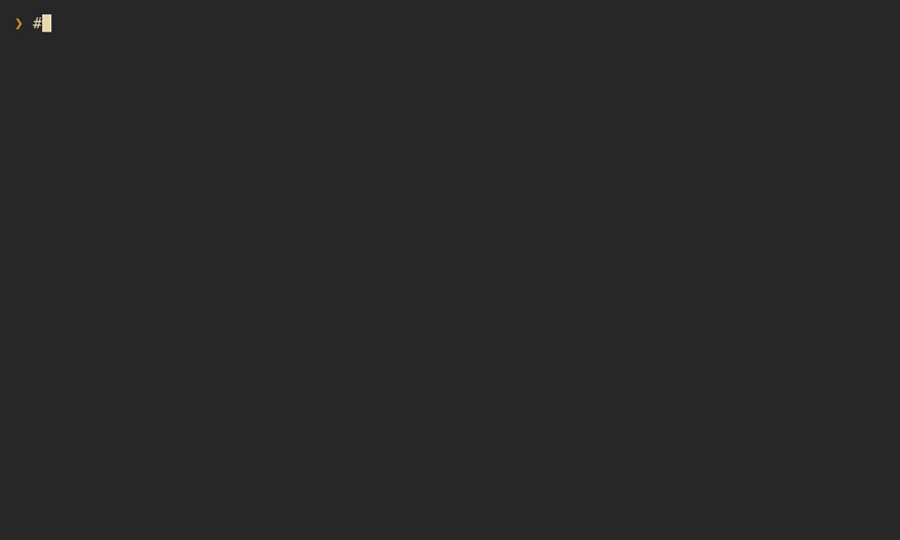

# ada


_Named after Ada, regal matriarch, at her behest._

A terminal markdown viewer for notes you walk between: follow links and come back to where you
were, see what git says changed, read wide tables at any width, and look at the pictures.

`ada` renders CommonMark and GitHub-flavoured markdown with `[[wiki links]]`, highlights code
in some 200 languages, and shows images inline in terminals that can (kitty, sixel, iTerm2).
It isn't only for markdown: code, config and other text files open highlighted, and png and
jpeg files full screen, whether named on the command line or reached through a link
([Other files](#other-files)).


<details>
<summary>A longer tour: links and history, code files, tables, search, images, live reload, themes and <code>--print</code></summary>



</details>

## Features

- CommonMark and GFM: tables, task lists, footnotes and callouts (`> [!NOTE]`)
- tables sized like a browser's, with a sticky header; too-wide tables become cards (`t`);
  sortable by any column (`s`)
- syntax-highlighted code; long lines wrap or scroll sideways (`w`)
- code, config and other text files shown whole and highlighted, and image files shown to fit
  the screen; links to them open in ada, `src/main.rs#L42` at its line
- links: relative paths, `[[wiki]]`, anchors and footnotes, with back/forward history
- git gutter for staged and unstaged changes; `]c`/`[c` to jump between them
- inline images, and full screen from any linked png or jpeg
- regex search that sees through markup: `foo bar` finds `**foo** _bar_`
- a filterable heading outline, and a filterable list of links
- live reload, and `e` to edit at the current line
- `y` to copy the focused link or visible code block (OSC 52)
- three built-in themes, and your own; `T` previews each before you pick one
- themes, keys and options in one config file
- `--print` for pipes and fzf previews

## Install

```zsh
cargo install --path .
```

Rust 1.99 or newer, and a C compiler: syntax highlighting runs on
[Oniguruma](https://github.com/kkos/oniguruma), which is built from source. For a pure-Rust
build, use `cargo install --path . --no-default-features`. Highlighting then runs on
fancy-regex and looks the same, but each language costs 10–20 ms on first use instead of about
1 ms. Git integration runs the `git` command.

## Usage

```zsh
# read a note
ada notes/today.md

# from a pipe
git show HEAD~3:README.md | ada

# start at line 120
ada --line 120 notes/today.md

# not only markdown: code and config files, highlighted, and images
ada src/main.rs
ada ~/.config/ada/config.toml
ada plot.png

# print instead of paging: what happens anyway when stdout isn't a terminal
ada --print --width 100 notes/today.md | less -R
```

As an fzf preview, which prints at the pane's width (`$FZF_PREVIEW_COLUMNS`):

```zsh
fzf --preview 'ada --print {}'
```

Press `?` in ada for the keys. See `ada --help` for every option.

### Keys

| Keys | Action |
|---|---|
| `j` `k`, `↓` `↑`, `C-e` `C-y` | scroll a row |
| `d` `u`, `C-d` `C-u` | half a page |
| `Space` `b`, `PgDn` `PgUp`, `C-f` `C-b` | a page |
| `g` `G`, `Home` `End` | top, bottom |
| `]]` `[[` | next, previous heading |
| `]c` `[c` | next, previous git change |
| `Tab` `S-Tab` | focus the next, previous link |
| `Enter` | follow the focused link |
| `BS` `H` `C-o`, `L` | back, forward |
| `/`, `n` `N` | search with a regex, next and previous match |
| `o` | the outline: type to filter, `Enter` to jump |
| `l` | the links: type to filter, `Enter` to focus one |
| `t` | tables: auto, grid, records |
| `s` | sort a table on screen by a column: ascending, descending, source order; `←` `→` pick another table |
| `w`, `←` `→` | wrap code, or scroll it sideways |
| `T` | pick a theme, previewing each: `Enter` keeps it, `Esc` goes back |
| `r` | read the file again |
| `e` | edit in `$VISUAL` or `$EDITOR` at the current line |
| `y` | copy the focused link, or the code block on screen |
| `?` | help |
| `q` `Esc` | quit; `C-c` always quits |

In the search prompt, `Enter` keeps the matches, `Esc` puts the previous search back, `C-u`
and `C-w` edit, and an empty pattern repeats the last search. Search is smart-case: it ignores case
unless the pattern has an uppercase letter. So are the filters of the outline, links, themes and
columns lists.

## Configuration

ada reads `~/.config/ada/config.toml` (or `$XDG_CONFIG_HOME/ada/config.toml`). The first time it
runs it writes that file with every option commented out at its default, so it's a place to
look as much as a place to change things. Flags on the command line win.

```toml
theme = "gruvbox-light"
max_width = 100            # wrap prose at most 100 columns wide; tables may use the rest
images = true              # or false for text only
image_protocol = "auto"    # or kitty, sixel, iterm2, halfblocks
live_reload = true         # look at the file's time once a second
tables = "auto"            # the table layout to start with: auto, grid or records
code_wrap = true

[keys]
# setting an action replaces its keys; keys it takes from another action leave it
scroll_down = ["j", "down", "ctrl-n"]
top = "g g"
quit = "q"
```

Keys are written like `j`, `G`, `ctrl-d`, `alt-x`, `shift-up`, `space`, `enter`, `esc`, `tab`,
`shift-tab`, `pageup`, `f5`; two keys pressed in turn as `"]]"` or `"g g"`. The help (`?`) shows
the keys in use.

### Themes

Three themes are built in, `gruvbox-dark` (the default), `gruvbox-light` and
`catppuccin-mocha`. Your own go in `~/.config/ada/themes/NAME.toml` and are picked with `--theme NAME` or `theme = "NAME"`; `T`
lists all of them, previewing each as it's selected: `Enter` keeps it, `Esc` goes back. A theme can start from another and change only some of it:

```toml
extends = "gruvbox-dark"

[inline]
emph = { fg = "#d3869b", italic = true }
link = { fg = "aqua", underline = false }

[glyphs]
bullets = ["-", "+", "*"]
table_border = "ascii"
```

Colors are `#rrggbb`, `#rgb`, a terminal color name or index, or a name from the theme's
`[palette]`. The built-in
[gruvbox-dark.toml](src/theme/builtin/gruvbox-dark.toml) lists every style there is. Mistakes
are reported with the file, line and column.

## Other files

ada goes by the file's name: markdown is rendered, a png or jpeg is shown as large as the screen
allows, and a file whose name a syntax claims (`main.rs`, `Cargo.lock`, `Makefile`, `.zshrc`) is
shown whole as highlighted code, full width, with the git gutter, search, `e` and `--line`
working on its lines. Failing that, a `#!` first line names the language, and other text is shown
plain, except files with no extension at all, which are read as markdown. Binary files aren't
shown. Stdin is always markdown.

## Images

Block images, the ones alone in their paragraph, are drawn inline, and `Enter` on any link to a
png or jpeg shows it full screen (`Enter` again opens it in your image viewer). ada asks the
terminal what it supports:

- kitty, and terminals with its graphics protocol, get crisp images that scroll cleanly
- foot, wezterm, and other sixel terminals get sixel
- the rest get half-block characters

Inside tmux, kitty graphics don't work, so ada uses sixel when tmux and the terminal both
support it, and half-blocks otherwise. `--image-protocol` overrides what ada picks, and
`--no-images` turns images off.

## Editing

`e` opens the file in `$VISUAL`, then `$EDITOR`, then `vi`, at the first line on screen: as
`+LINE FILE` for vi, vim, neovim, nano, emacs, kakoune and micro, as `FILE:LINE` for helix, and
as just `FILE` for anything else. The setting is split like a shell would, so
`EDITOR="code --wait"` works. ada reads the file again when the editor exits.

## Shell completions

```zsh
ada --completions zsh > ${XDG_DATA_HOME:-~/.local/share}/zsh/completions/_ada
ada --completions bash > ${XDG_DATA_HOME:-~/.local/share}/bash-completion/completions/ada
ada --completions fish > ${XDG_CONFIG_HOME:-~/.config}/fish/completions/ada.fish
```

Or source it from `~/.zshrc`, after `compinit`: `source <(ada --completions zsh)`. Theme names
complete from the built-ins and your themes directory.

## Recording sessions

`--record FILE` writes down what happens in a session: what each key did, resizes, and the
files and git output ada read, as plain text in the order it happened. `--replay FILE` plays it
back exactly, even after the files have changed, which makes a bug report out of a session.
`--headless` replays it off-screen and prints the last frame.

## Demos

The recordings above are made with [VHS](https://github.com/charmbracelet/vhs) from
`demo/short.tape` and `demo/tour.tape`, which read the made-up notes in `demo/notes` from a
scratch git repository and a config of their own. To record them again:

```zsh
cargo build --release
vhs demo/short.tape
vhs demo/tour.tape
```

## License

[MIT](LICENSE)
