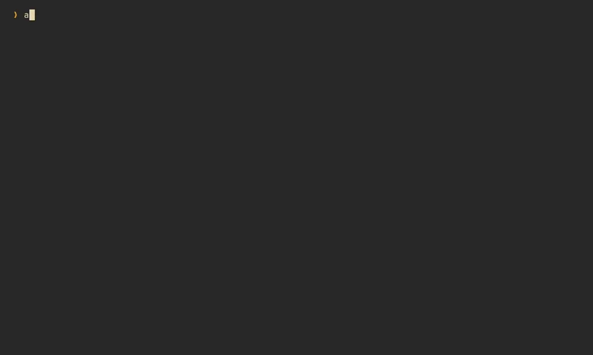

# ada


_Named after Ada, regal matriarch, at her behest._

A fast terminal markdown viewer, for one file or a whole vault of notes: follow links and come
back to where you were, see what git says changed, read wide tables at any width, and look at
the pictures.

`ada` renders CommonMark and GitHub-flavored markdown with `[[wiki links]]`, highlights code
in some 200 languages, and shows images inline in terminals that can (kitty, sixel, iTerm2).



More of it, one feature at a time, on [the site](https://junkdog.github.io/ada-md/).

## Goals

- **The fastest markdown viewer, and the leanest:** wall time, CPU and memory are all measured,
  against the other terminal viewers and against ada's own budgets. A key draws its frame in
  well under a millisecond whatever the document's size, an idle ada sleeps until something
  happens, and a typical note takes about 11 MiB of memory.
- **A curated feature set:** what a single markdown file needs, and what matters once files
  link to each other, as in an
  [LLM wiki](https://gist.github.com/karpathy/442a6bf555914893e9891c11519de94f) or an
  Obsidian-style vault. The rest (a file browser, editing, mermaid, math) stays out.
- **No crashes, on any input.** Parsing, layout and drawing are safe Rust; ada's only `unsafe` is
  one call at startup that sets a malloc option. Every interaction is a message, so a
  recorded session replays to identical frames. Whole scripted sessions are fuzzed for hours at a
  time: documents, keys, resizes, and file, git and image results that arrive late, out of order,
  or after their document is gone.

## Standout features

- **Tables you can work with:** sort by any column, by value (`s`), with the header row kept on
  screen while a long table scrolls; too wide, and it turns into cards ([Tables](#tables))
- **Links you can walk:** relative paths, `[[wiki links]]`, anchors and `src/main.rs#L42`, with
  back and forward history that comes back to the same spot and the same focused link
- **Not only markdown:** code, config and other text files open whole and highlighted, in some
  200 languages, and png and jpeg files full screen, from the command line or through a link
  ([Other files](#other-files))
- **A git gutter** that marks staged and unstaged changes in the rendered note; `]c` `[c` jump
  between them
- **Search that sees through markup:** a regex `foo bar` finds `**foo** _bar_`, and link
  targets match too
- **Inline images** over kitty, sixel or iTerm2, with half-blocks as the fallback, and inside
  tmux
- **Live reload** the moment the file changes, and `e` to edit at the line on screen
- **`--print`** for pipes and fzf previews, and `--record` and `--replay` to make a bug report
  from a session

Also: callouts, footnotes and task lists, a filterable outline and list of links, code that
wraps or scrolls sideways, fourteen built-in themes and your own (`T` previews them), and keys
you can remap.

## Performance

ada against other terminal markdown viewers, on the same machine, documents and 120×40 pty:
four notes from 13 KB to a 2 MB concatenation, each viewer pinned to four physical cores of an
AMD Ryzen AI MAX+ PRO 395, medians of 3–5 runs (ada `3202a1a`, 2026-10-17).

ada is first in 78 of the 84 interactive measurements, on time and on CPU or memory, and
prints faster and in less memory than the other highlighting printers. It isn't first on the
bytes it writes per page (glow writes about a third less) or on peak memory for the smallest
note (md-tui, 9.3 MiB against 10.8).

The charts, per document and with what each one times, are on
[the site](https://junkdog.github.io/ada-md/#performance). The medians behind them are in
[`interactive.dat`](bench/b2/plots/interactive.dat) and [`print.dat`](bench/b2/plots/print.dat),
and the harness and how to run it in [`bench/b2`](bench/b2/README.md).

## Install

```zsh
cargo install --path .
```

Rust 1.99 or newer, and a C compiler: syntax highlighting runs on
[Oniguruma](https://github.com/kkos/oniguruma), which is built from source. For a pure-Rust
build, use `cargo install --path . --no-default-features`. Highlighting then runs on
fancy-regex and looks the same, but each language costs 10–20 ms on first use instead of about
1 ms. Git integration runs the `git` command.

## Usage

```zsh
# read a note
ada notes/today.md

# from a pipe
git show HEAD~3:README.md | ada

# start at line 120
ada --line 120 notes/today.md

# not only markdown: code and config files, highlighted, and images
ada src/main.rs
ada ~/.config/ada/config.toml
ada plot.png

# with line numbers: off, code (code and text files) or all (markdown too)
ada -n all notes/today.md

# print instead of paging: what happens anyway when stdout isn't a terminal
ada --print --width 100 notes/today.md | less -R
```

As an fzf preview, which prints at the pane's width (`$FZF_PREVIEW_COLUMNS`):

```zsh
fzf --preview 'ada --print {}'
```

Press `?` in ada for the keys. See `ada --help` for every option.

### Keys

| Keys | Action |
|---|---|
| `j` `k`, `↓` `↑`, `C-e` `C-y` | scroll a row |
| `d` `u`, `C-d` `C-u` | half a page |
| `Space` `b`, `PgDn` `PgUp`, `C-f` `C-b` | a page |
| `g` `G`, `Home` `End` | top, bottom |
| `]]` `[[` | next, previous heading |
| `]c` `[c` | next, previous git change |
| `Tab` `S-Tab` | focus the next, previous link |
| `Enter` | follow the focused link |
| `BS` `H` `C-o`, `L` | back, forward |
| `/`, `n` `N` | search with a regex, next and previous match |
| `o` | the outline: type to filter, `Enter` to jump |
| `l` | the links: type to filter, `Enter` to focus one |
| `t` | tables: auto, grid, records |
| `s` | sort a table on screen by a column: ascending, descending, source order; `←` `→` pick another table |
| `w`, `←` `→` | wrap code, or scroll it sideways |
| `#` | show or hide line numbers, for code files or for markdown, whichever is shown |
| `T` | pick a theme, previewing each: `Enter` keeps it, `Esc` goes back; `←` `→` list the dark or the light themes |
| `r` | read the file again |
| `e` | edit in `$VISUAL` or `$EDITOR` at the current line |
| `y` | copy the focused link, or the code block on screen |
| `?` | help |
| `q` `Esc` | quit; `C-c` always quits |

In the search prompt, `Enter` keeps the matches, `Esc` puts the previous search back, `C-u`
and `C-w` edit, and an empty pattern repeats the last search. Search is smart-case: it ignores case
unless the pattern has an uppercase letter. So are the filters of the outline, links, themes and
columns lists.

## Configuration

ada reads `~/.config/ada/config.toml` (or `$XDG_CONFIG_HOME/ada/config.toml`). The first time it
runs it writes that file with every option commented out at its default, so it's a place to
look as much as a place to change things. Flags on the command line win.

```toml
theme = "gruvbox-light"
max_width = 100            # wrap prose at most 100 columns wide; tables may use the rest
images = true              # or false for text only
image_protocol = "auto"    # or kitty, sixel, iterm2, halfblocks
live_reload = true         # read the file again when it changes
tables = "auto"            # the table layout to start with: auto, grid or records
code_wrap = true
line_numbers = "code"      # number rows by source line: off, code (code and text files) or all

[keys]
# setting an action replaces its keys; keys it takes from another action leave it
scroll_down = ["j", "down", "ctrl-n"]
top = "g g"
quit = "q"
```

Keys are written like `j`, `G`, `ctrl-d`, `alt-x`, `shift-up`, `space`, `enter`, `esc`, `tab`,
`shift-tab`, `pageup`, `f5`; two keys pressed in turn as `"]]"` or `"g g"`. The help (`?`) shows
the keys in use.

### Themes

These themes are built in:

| family | themes |
|---|---|
| gruvbox | `gruvbox-dark` (the default), `gruvbox-light` |
| catppuccin | `catppuccin-mocha`, `catppuccin-macchiato`, `catppuccin-frappe`, `catppuccin-latte` |
| tokyonight | `tokyonight-night`, `tokyonight-storm`, `tokyonight-moon`, `tokyonight-day` |
| rosé pine | `rose-pine`, `rose-pine-moon`, `rose-pine-dawn` |
| dracula | `dracula` |

Your own go in `~/.config/ada/themes/NAME.toml` and are picked with `--theme NAME` or `theme = "NAME"`; `T`
lists all of them, previewing each as it's selected: `Enter` keeps it, `Esc` goes back. It lists the dark themes or the
light ones, whichever the current theme is, and `←` `→` switch, landing on the counterpart (`gruvbox-dark` ↔ `gruvbox-light`). A theme can start from another and change only some of it:

```toml
extends = "gruvbox-dark"

[inline]
emph = { fg = "#d3869b", italic = true }
link = { fg = "aqua", underline = false }

[glyphs]
bullets = ["-", "+", "*"]
table_border = "ascii"
```

Colors are `#rrggbb`, `#rgb`, a terminal color name or index, or a name from the theme's
`[palette]`. The built-in
[gruvbox-dark.toml](src/theme/builtin/gruvbox-dark.toml) lists every style there is. Mistakes
are reported with the file, line and column.

## Tables

Notes are full of tables: costs, timings, versions, lists of things to compare. ada treats them
as more than text.

- **Sort by any column.** `s` lists the columns of the first table on screen, each ascending
  and descending; type to filter (`cost desc`), and `Enter` sorts. `←` `→` switch to another
  table on screen, and once a table is sorted, the list also offers its source order back.
  On a sorted table, `s Enter` flips its order. Each table keeps its own order, through
  resizes, going back and forth, theme switches, and reloads that keep the column.
- **By value, not as text.** Numbers sort as numbers, with signs, thousands separators and
  currency or percent signs (`€85` before `€310`), and durations as durations, in any mix of
  units (`5 min` before `45 min`, `1h 30m` after `80m`). Everything else sorts naturally, digit
  runs by value and case ignored. Empty cells go last either way, and ties keep their order.
  The column shows `▲` or `▼`, and the status line says what the table is sorted by.
- **A sticky header.** While a long table scrolls past, its header row stays at the top of the
  screen, so you always know which column is which.
- **Sized like a browser's.** Column widths follow their content, and a table may grow past
  `max_width`, up to the terminal's width, while the prose around it stays narrow. A table that
  still doesn't fit becomes cards, one per row, each cell beside its header, instead of columns
  three characters wide. `t` cycles every table between auto, grid and cards (records).

## Other files

ada goes by the file's name: markdown is rendered, a png or jpeg is shown as large as the screen
allows, and a file whose name a syntax claims (`main.rs`, `Cargo.lock`, `Makefile`, `.zshrc`) is
shown whole as highlighted code, full width, with the git gutter, search, `e` and `--line`
working on its lines. Failing that, a `#!` first line names the language, and other text is shown
plain, except files with no extension at all, which are read as markdown. Binary files aren't
shown. Stdin is always markdown.

## Images

Block images, the ones alone in their paragraph, are drawn inline, and `Enter` on any link to a
png or jpeg shows it full screen (`Enter` again opens it in your image viewer). ada asks the
terminal what it supports:

- kitty, and terminals with its graphics protocol, get crisp images that scroll cleanly
- foot, wezterm, and other sixel terminals get sixel
- the rest get half-block characters

Inside tmux, ada uses half-blocks: kitty graphics don't work there, and sixel and iTerm2 images
get misplaced and lost on tmux's redraws ([KNOWN_ISSUES.md](KNOWN_ISSUES.md)). `--image-protocol`
overrides what ada picks, and `--no-images` turns images off.

## Editing

`e` opens the file in `$VISUAL`, then `$EDITOR`, then `vi`, at the first line on screen: as
`+LINE FILE` for vi, vim, neovim, nano, emacs, kakoune and micro, as `FILE:LINE` for helix, and
as just `FILE` for anything else. The setting is split like a shell would, so
`EDITOR="code --wait"` works. ada reads the file again when the editor exits.

## Shell completions

```zsh
ada --completions zsh > ${XDG_DATA_HOME:-~/.local/share}/zsh/completions/_ada
ada --completions bash > ${XDG_DATA_HOME:-~/.local/share}/bash-completion/completions/ada
ada --completions fish > ${XDG_CONFIG_HOME:-~/.config}/fish/completions/ada.fish
```

Or source it from `~/.zshrc`, after `compinit`: `source <(ada --completions zsh)`. Theme names
complete from the built-ins and your themes directory.

## Recording sessions

`--record FILE` writes down what happens in a session: what each key did, resizes, and the
files and git output ada read, as plain text in the order it happened. `--replay FILE` plays it
back exactly, even after the files have changed, which makes a bug report out of a session.
`--headless` replays it off-screen and prints the last frame.

## Demos

The recording above is made with [VHS](https://github.com/charmbracelet/vhs) from
`demo/demo.tape`, which reads the made-up notes in `demo/notes` from a scratch git repository
and a config of its own; it's also the site's hero. VHS writes a GIF (`demo/demo.gif`, not kept in
git), and ffmpeg makes the animated WebP shown here, at less than half the size. The site's clips
are recorded by `site/build.zsh`. To record the demo again:

```zsh
cargo build --release
vhs demo/demo.tape
ffmpeg -y -i demo/demo.gif -c:v libwebp_anim -quality 80 -loop 0 site/media/hero.webp
```

## License

[MIT](LICENSE)
