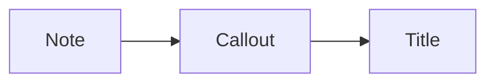

# Obsidian's markdown

Each Obsidian feature, with what ada does with it today, so you can check them all in one place: `ada --flavor obsidian examples/obsidian.md` (a note under a `.obsidian` folder reads as Obsidian's without the flag). The ids are the vault backlog's (OBS-nnn), in the order a survey of 175 vaults ranked them; this file changes with each of them.

## Front matter and properties (OBS-010)

*ada: the front matter above shows as this note's properties, a dim row for each key, its tags as tags; `p` hides them, and `properties = "source"` shows them as written. In a vault, `[[Obsidian showcase]]` in another note reaches this one by its alias.*

## Single line breaks (OBS-001)

*ada: in Obsidian's flavor, each newline below breaks the line, unless the vault turns on Strict line breaks; in CommonMark's, they join.*

Created: 2026-11-22
Status: draft
Steps: one, two, three

## Callouts (OBS-002)

*ada: GitHub's five kinds and Obsidian's thirteen with their aliases, titles with markup, nesting; a callout that folds shows `▾` and starts open.*

> [!note]
> The default kind. An unknown kind, `[!theorem]` below, draws as a note under its own name.

> [!abstract] Abstract, also `summary` and `tldr`

> [!info] Info

> [!todo] Todo

> [!tip] Tip, also `hint` (and `important` in Obsidian)

> [!success] Success, also `check` and `done`

> [!question]- Question, also `help` and `faq`, folded in Obsidian
> Shown open: a pager hides nothing you came to read.

> [!warning]+ Warning, also `attention` (and `caution` in Obsidian), foldable and open

> [!failure] Failure, also `fail` and `missing`

> [!danger] Danger, also `error`

> [!bug] Bug

> [!example] Example

> [!quote] Quote, also `cite`
> Callouts include additional content without breaking the flow of your notes.

> [!theorem] Pythagoras
> $a^2 + b^2 = c^2$

> [!info] A title with *emphasis*, `code` and a [[#Wiki links|wiki link]]
> The body, with **markdown**:
> - a list
> - in a callout

> [!question] Can callouts be nested?
> > [!todo] Yes, they can.
> > > [!example] You can even use multiple layers of nesting.

GitHub's alerts, which outside Obsidian keep GitHub's colors for `important` and `caution`:

> [!IMPORTANT]
> Crucial information.

> [!CAUTION]
> Negative potential consequences.

## Math (OBS-003)

*ada: typeset as Unicode text, in any note: Greek, operators and arrows, `\mathbb{R}` as ℝ, scripts where Unicode has their letters (a script with a `*` among them written out), fractions as a/b, a root over more than one factor in parentheses; display math set centered, its rows aligned on their `&`, matrices and cases drawn tall. Search finds the math by what it shows and by its TeX. TeX ada doesn't read (a macro of your own) shows as written, as code, as does shell or prose that two dollar signs happen to hold. A price, $5 or $10, stays text.*

Inline, $e^{i\pi} + 1 = 0$, $x \in \mathbb{R}^n$, $\mathcal{O}(n \log n)$, $\frac{1}{\sigma\sqrt{2\pi}}$ beside $\sqrt{2}\pi$, and $5^{10*13+4}$ beside $x^*$; on its own lines:

$$
\sum_{k=1}^{n} k = \frac{n(n+1)}{2}
$$

$$
\begin{aligned}
f(x) &= x^2 + 2x + 1 \\
     &= (x+1)^2
\end{aligned}
$$

$$
A = \begin{pmatrix} 1 & 0 \\ 0 & 1 \end{pmatrix}, \quad
|x| = \begin{cases} x & x \ge 0 \\ -x & x < 0 \end{cases}
$$

A macro of the vault's own stays TeX: $\RR^n$.

## Comments (OBS-004)

*ada: in Obsidian's flavor, hidden, inline or over many lines, the markdown inside too; one never closed hides the rest of the note, as in Obsidian. A `%%` in code opens none. In CommonMark's, shown as written.*

This is an %%inline%% comment.

%%
A block comment, with *markdown* that Obsidian never renders.

- a list
- hidden with it
%%

In code, `printf("%%d")` stays as written.

## Highlights (OBS-005)

*ada: on the theme's highlight color, in any flavor, across emphasis and links; the color emoji after a `==` stays, as text. A `==` with spaces on both sides isn't one: a == b.*

This is ==highlighted== text, ==with *emphasis* and a [[#Tags (OBS-006)|link]] inside==.

==🔴Important==, ==🟡Remember this==.

## Tags (OBS-006)

*ada: in Obsidian's flavor, drawn as Obsidian's pills, in the theme's tag color: a `#` after a space or at a line's start, then letters, digits, `_`, `-` or `/`, at least one not a digit. `#12`, C#, a URL's `#` and `#code` aren't tags. In CommonMark's, plain text.*

#obsidian #ada/showcase #2026-review

## Note embeds (OBS-007)

*ada: an embed alone in its paragraph draws the note in place, behind a bar under its link (`↳ lexers#Rust`, `Enter` follows it): the whole note but its properties, the heading's section, or the block a `#^id` names; its rows are the embed's line. Beside other text, an embed is its link, as is one of a note ada can't find, or of a note already being drawn (no note draws inside itself).*

![[lexers#Rust]]

The whole of ![[lexers]] stays a link here, as it has text beside it.

## Image size (OBS-008)

*ada: `|200` caps the image at 200 pixels across (`|200x100` down too), as the terminal's cells measure them, its shape kept and never enlarged; the size is no caption.*

![[../ada.jpg|200]]

## Block ids and block references (OBS-009)

*ada: in Obsidian's flavor, a `^id` at the end of a paragraph or list item is hidden and names it, and one alone on its line names the list, quote or table above it; in CommonMark's it shows, and names the block all the same. `[[note#^id]]` leads to the block, and `![[note#^id]]` alone in its paragraph draws it in place, as the note embeds above draw a section.*

A paragraph with a block id. ^showcase-block

- a list item with one ^showcase-item
  - and its child

| a table | named |
|---|---|
| by the id | below it |

^showcase-table

Links to them: [[#^showcase-block]], [[#^showcase-item]] and [[#^showcase-table]].

## Front matter with a blank second line (OBS-011)

*ada: front matter whose second line is blank, as Excalidraw writes it, is front matter in Obsidian's flavor, and in an Excalidraw drawing in any; in CommonMark's, it's a rule and a heading, as CommonMark reads it. A note holds one front matter, so this one has none of its own.*

## Custom task statuses (OBS-012)

*ada: in any flavor, the statuses of Obsidian's themes and the Tasks plugin draw as task boxes of their own, each a mark in the theme's brackets (`[glyphs.task_status]`), colored by the callout it's nearest. A letter or a digit in brackets (`- [a] option`, `- [1] Knuth`) stays text, as other markdown means it.*

- [ ] To do
- [x] Done
- [/] In progress
- [-] Cancelled
- [>] Forwarded
- [<] Scheduled
- [!] Important
- [?] A question
- [*] A star

## Vault-root paths in markdown links (OBS-013)

*ada: a markdown link's path is found beside the note, else from the vault's root, as Obsidian's absolute link format writes it (here the repository is no vault, so the first link is found only when a folder above is a root: `[links] roots`). A heading under another, `[[note#A#B]]`, is found as Obsidian writes it.*

[A path from the vault's root](examples/lexers.md), and [[lexers#ada-parse's lexers#Bash|a heading under another]].

## Inline footnotes (OBS-014)

*ada: open: shown as written.*

An inline footnote.^[Its text, written where it's referenced.]

## Excalidraw drawings (OBS-015)

*ada: in any flavor, a `.excalidraw.md` drawing is a notice, then its text as Obsidian's flavor reads it, its block ids hidden; the plugin's banner and the drawing's data are left out. Its embed draws the same, as a note's does. Drawing it is out of scope.*

![[sketch.excalidraw]]

## Canvas and Bases (OBS-016)

*ada: open: `.canvas` is highlighted JSON and `.base` YAML.*

## Dataview and Tasks queries (OBS-017)

*ada: out of scope: the query shows as code.*

```dataview
TABLE created, tags FROM #obsidian SORT created DESC
```

## Already matching

### Wiki links

*ada: a note beside this one, or found by name under the vault's root; folder paths, headings and aliases.*

[[lexers]], [[lexers#Rust|Rust's sample]], [[#Callouts (OBS-002)]], [[examples/lexers|a folder path]].

### Image embeds

*ada: png, jpeg and a gif's first frame, beside the note, by a path, or by name anywhere under the vault's root (here there is none, so the path).*

![[../ada.jpg]]

### Footnotes and tasks

*ada: footnotes you can follow, task boxes.*

A footnote.[^1]

- [x] a task

[^1]: Its text, at the end.

### Mermaid

*ada: drawn as text.*


