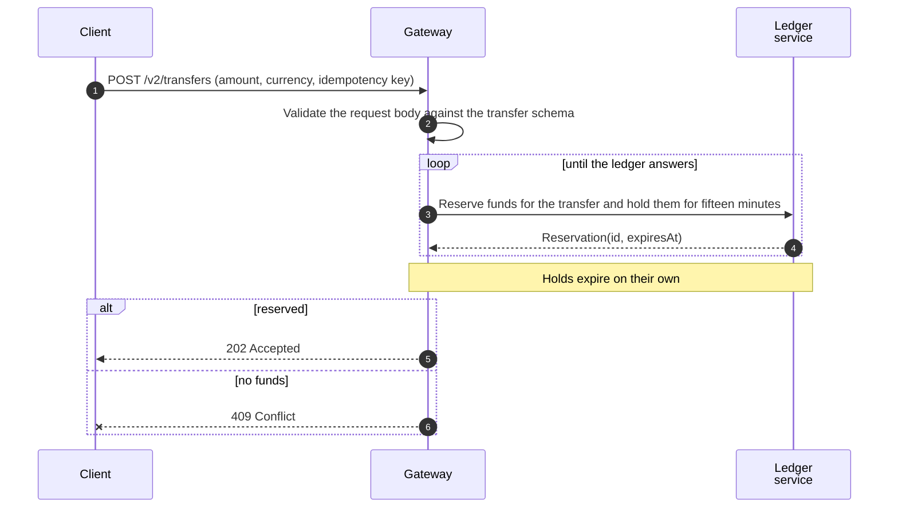
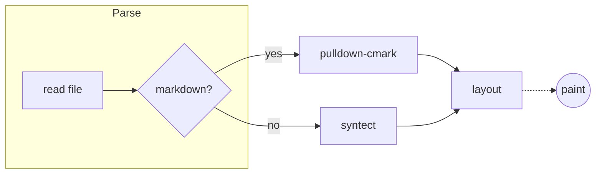
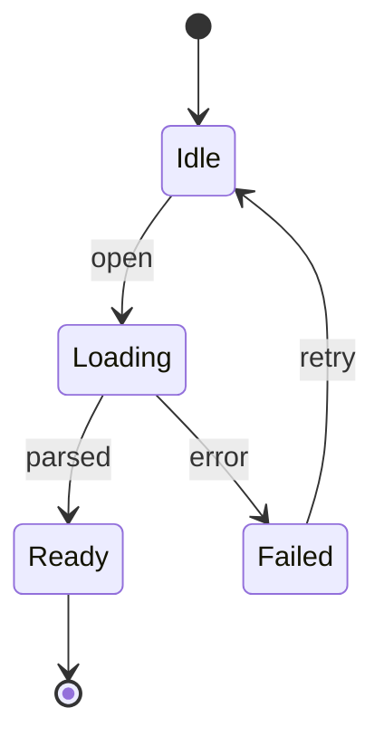
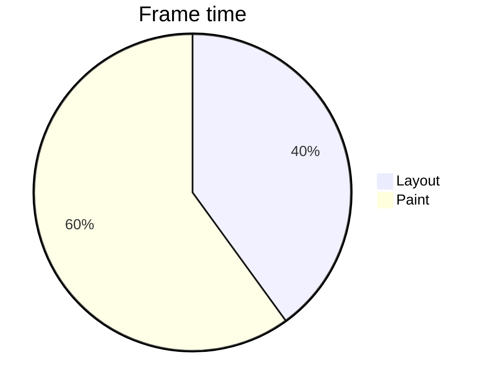

# Diagrams

A sequence diagram, drawn:



Inside a quote:

> ```mermaid
> sequenceDiagram
>     A->>B: hello
>     B-->>A: hi
> ```

A flowchart, with a subgraph:



A state diagram:



A kind ada doesn't draw stays source:



So does one that doesn't parse:

```mermaid
sequenceDiagram
    this is not a statement
```
